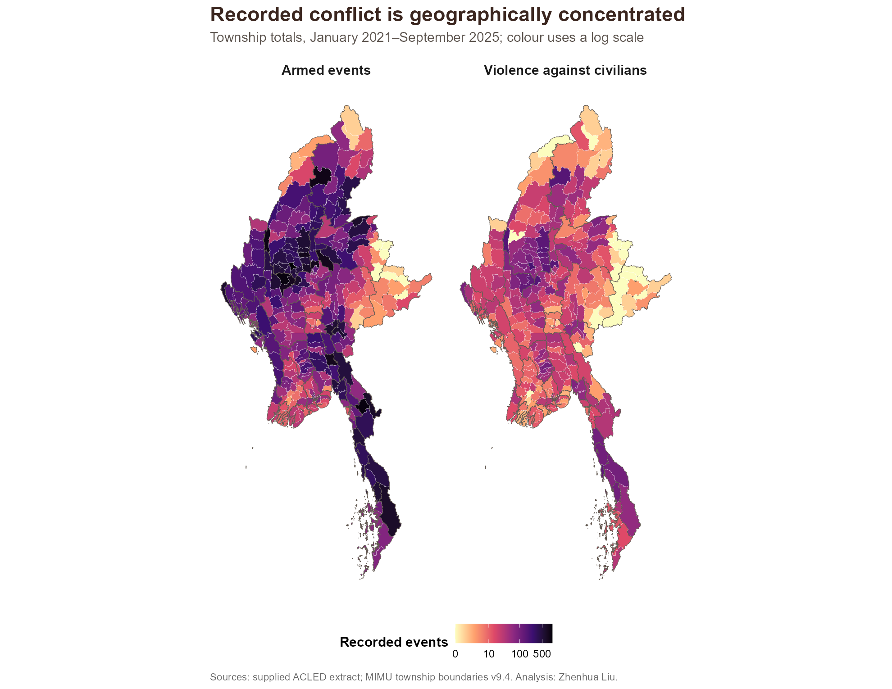
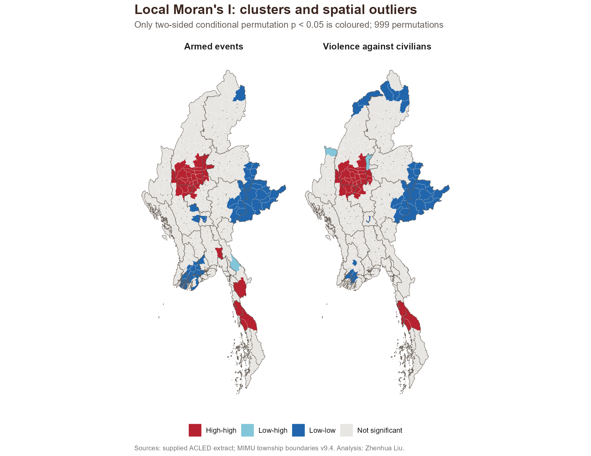
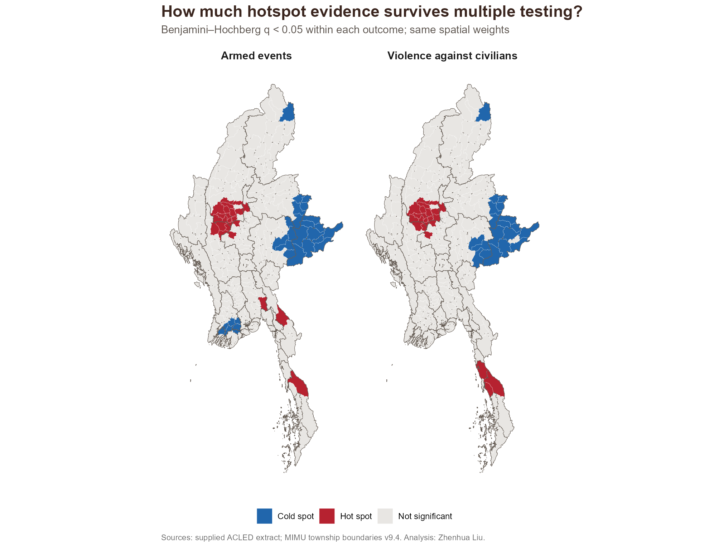
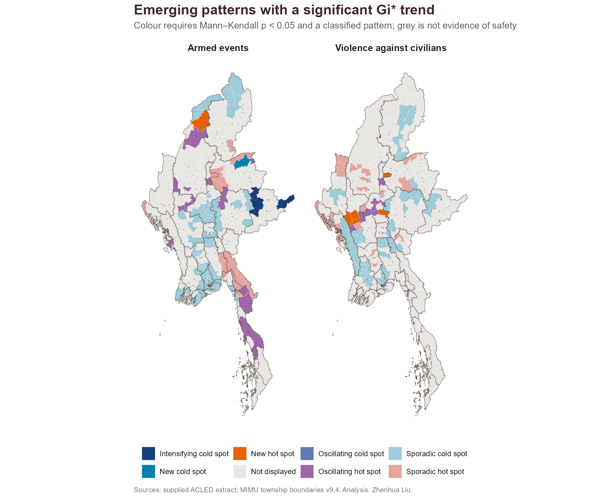
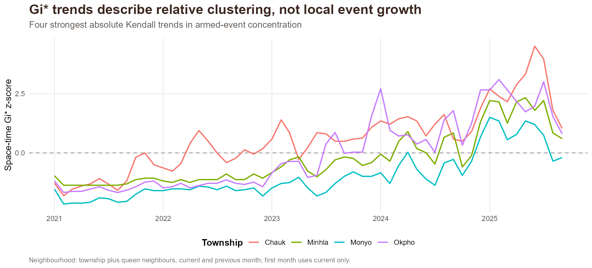
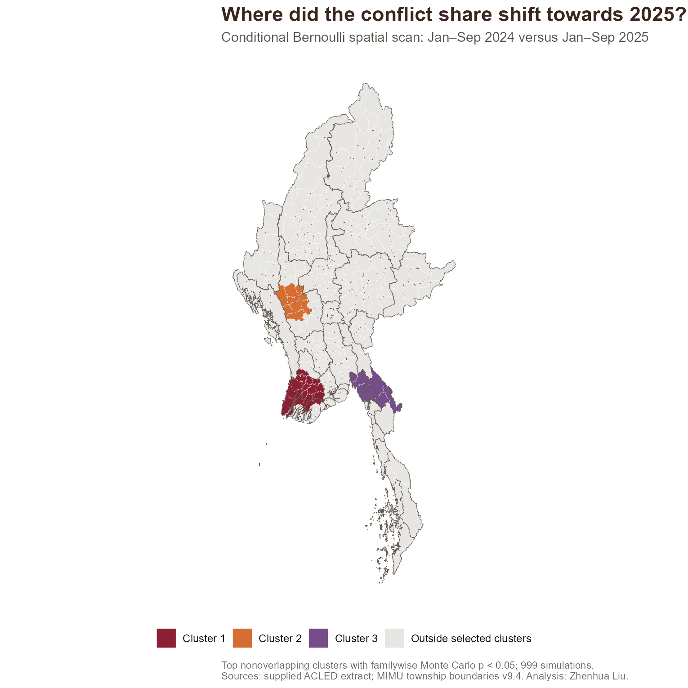

```{r}
#| include: false
options(warn=2)
suppressPackageStartupMessages({library(sf);library(dplyr);library(tidyr);library(readr)})
list2env(readRDS("take-home exercise2/data/derived/prepared.rds"),envir=environment())
list2env(readRDS("take-home exercise2/data/derived/analysis.rds"),envir=environment())
fmt <- function(x) format(x,big.mark=",",scientific=FALSE,trim=TRUE)
top <- st_drop_geometry(townships) |> arrange(desc(armed_events))
armed_lm <- lmsa |> filter(variable=="armed_events")
armed_eh <- ehsa |> filter(variable=="armed_events")
```

## Contents {.unnumbered}

1. Question and study design
2. Data quality and exclusions
3. Geographic burden
4. Neighbouring clusters and outliers
5. Hotspots and multiple testing
6. Emerging patterns
7. Trends and uncertainty
8. Recent geographic redistribution
9. Implications and limits

[Technical report](technical-report.qmd) · [Data and reproduction](README.md) · [GitHub](https://github.com/zhenhuaArhci/isss626-coursework/tree/main/take-home%20exercise2)

## 1. Where does conflict cluster, and where is it shifting?

::: {.columns}
::: {.column width="52%"}
### Study design

- **330 townships**, MIMU boundaries v9.4.
- **57 months**, January 2021–September 2025.
- **`r fmt(nrow(cube))` cells**, retaining zero observations.
- ACLED extract supplied with the coursework.
:::
::: {.column width="48%"}
### Three complementary questions

1. **Burden:** how many recorded events?
2. **Association:** do neighbours reinforce the pattern?
3. **Change:** where does relative concentration increase?
:::
:::

Two outcomes: **armed events** and the narrower **violence-against-civilians event type**. Counts represent recorded burden, not population risk.

## 2. Filtering protects township-level interpretation

::: {.columns}
::: {.column width="54%"}
| Processing stage | Records |
|---|---:|
| Supplied extract | 87,109 |
| Myanmar within study dates | 87,103 |
| Three armed-event categories | 54,000 |
| Coordinate precision 1–2 | 53,907 |
| Inside township polygons | **`r fmt(sum(cube$armed_events))`** |
| Violence against civilians | **`r fmt(sum(cube$civilian_events))`** |
:::
::: {.column width="46%"}
### Checks that affect the findings

- Unique IDs; no parsing failures.
- No unmatched points snapped onshore.
- **530 township-name disagreements**: geometry determines assignment.
- Approximate locations retained; code-1-only sensitivity.
- All 330 source polygons valid.
:::
:::

Raw ACLED records and MIMU vector files remain local. Reproduction uses exact input checksums and documented source paths.

## 3. A small set of townships carries a large share

The top ten townships account for **`r round(100*sum(head(top$armed_events,10))/sum(top$armed_events),1)`%** of included armed events. `r top$TS[1]` has the highest total (**`r fmt(top$armed_events[1])`**).

{height=550 fig-alt="Township count maps for armed events and violence against civilians."}

## 4. High counts and neighbouring clusters are different

Armed events: **`r sum(armed_lm$moran_class=="High-high")` high–high townships** and **`r sum(armed_lm$moran_class %in% c("High-low","Low-high"))` spatial outliers** at p < 0.05.

{height=550 fig-alt="Local Moran cluster maps with significant high-high, low-low and outlier categories."}

## 5. Multiple-testing correction changes the evidence

Armed-event hotspots fall from **`r sum(armed_lm$gi_p<.05 & armed_lm$gi_z>0)`** at nominal p < 0.05 to **`r sum(armed_lm$gi_q<.05 & armed_lm$gi_z>0)`** at BH q < 0.05. Both are reported.

{height=550 fig-alt="Hotspots surviving Benjamini-Hochberg adjustment for both event outcomes."}

## 6. Emerging patterns use the full space-time cube

Current + previous-month neighbours → Gi* series → Mann–Kendall trend → history classification. Only classified patterns with **MK p < 0.05** are coloured.

{height=540 fig-alt="Emerging hotspot categories filtered for significant Mann-Kendall trends."}

## 7. A trend in Gi* is a trend in relative concentration

Armed events: **`r sum(armed_eh$mk_p<.05)`** nominal MK trends; **`r sum(armed_eh$block3_p<.05)`** pass three-month block reordering and **`r sum(armed_eh$block6_p<.05)`** pass six-month blocks.

{height=410 fig-alt="Four Gi star time series illustrating the strongest absolute Kendall trends."}

Overlapping time neighbourhoods create serial dependence. Block reordering is an approximate sensitivity check. A falling concentration score can coexist with rising local counts.

## 8. The scan asks where the recent share increased

Equal-season comparison: **Jan–Sep 2024 versus Jan–Sep 2025**. The null preserves township totals and the national early/late totals; all **`r nrow(scan)` windows** enter the maximum-statistic correction.

::: {.columns}
::: {.column width="62%"}
{height=485 fig-alt="Top nonoverlapping conditional spatial scan clusters."}
:::
::: {.column width="38%"}
```{r}
knitr::kable(scan_top |> transmute(Centre=centre,Townships=townships,Ratio=round(rr,2),p=familywise_p))
```

The ratio compares **late-event proportions** inside and outside each window. It measures redistribution of recorded events, not residents' risk.
:::
:::

## 9. Use the evidence to guide contextual verification

::: {.columns}
::: {.column width="51%"}
### Humanitarian implications

- Review sustained burden and neighbouring concentrations together.
- Examine civilian-event clusters separately.
- Verify changing areas with local partners, displacement estimates and current access information.
:::
::: {.column width="49%"}
### Limits that matter

- Reporting coverage and approximate locations affect counts.
- Township scale, island links and weighting choices affect inference.
- Many tests and temporal dependence weaken simple significance claims.
- Historical data end in September 2025; grey areas are not evidence of safety.
:::
:::

[Full methods, sources and results](technical-report.qmd) · [Reproducible project on GitHub](https://github.com/zhenhuaArhci/isss626-coursework/tree/main/take-home%20exercise2)
