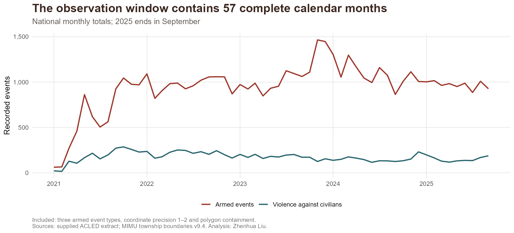
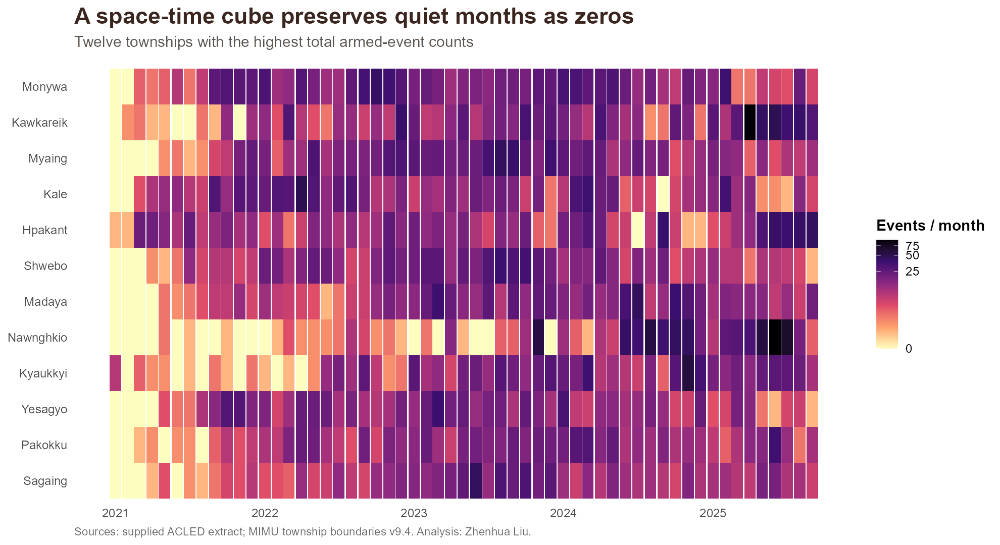
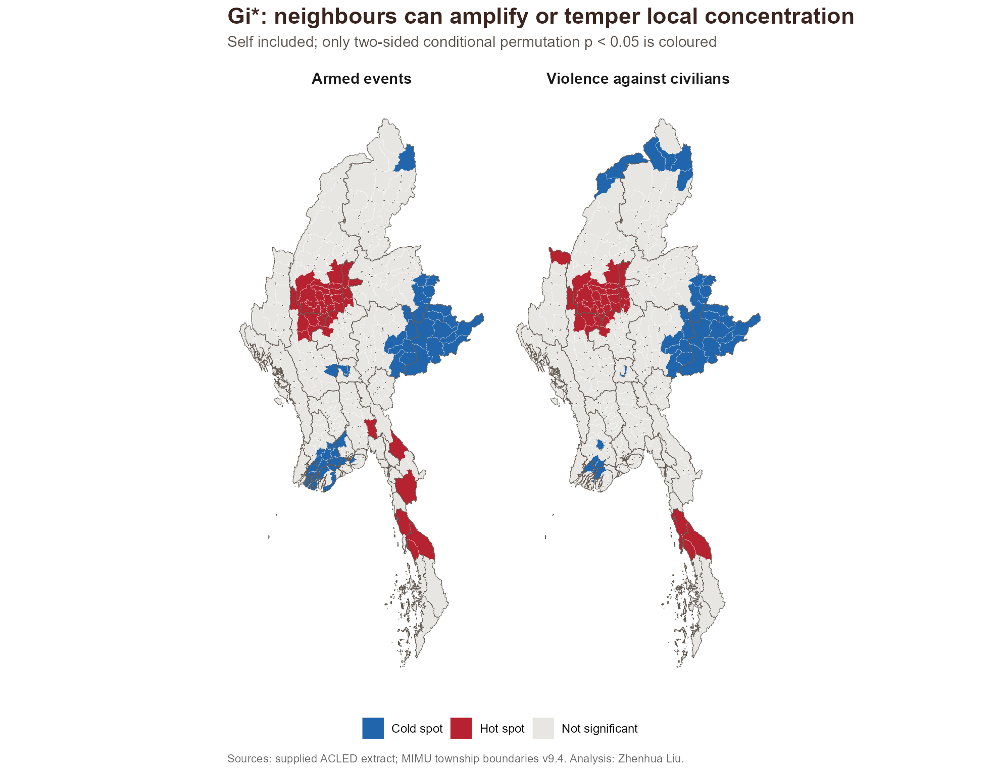
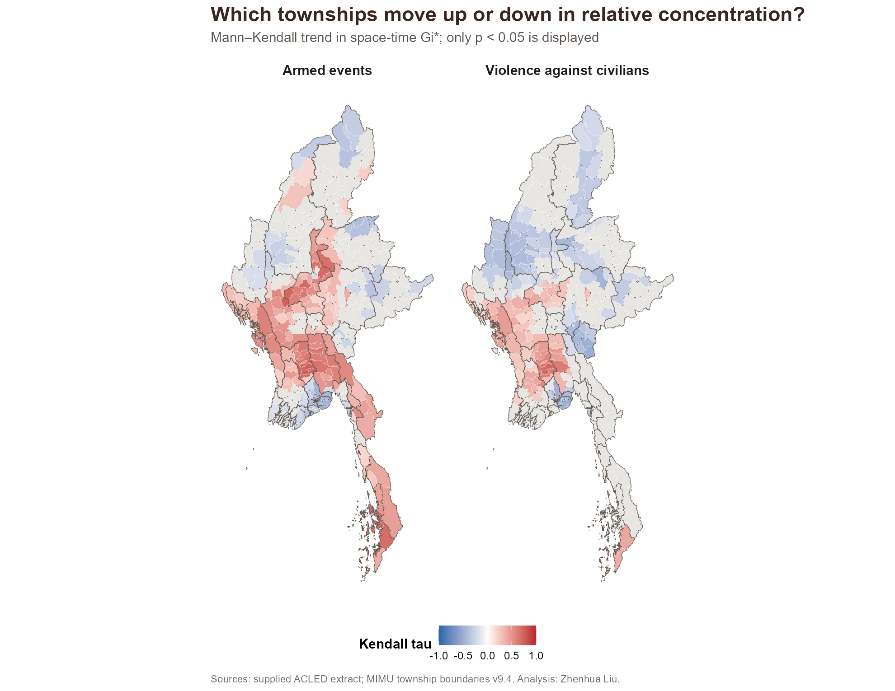

[Exercise entry](index.qmd) · [Executive summary](executive-summary.qmd) · [GitHub sources](https://github.com/zhenhuaArhci/isss626-coursework/tree/main/take-home%20exercise2)

```{r}
#| label: setup
#| include: false
options(warn=2)
source("take-home exercise2/R/run.R")
suppressPackageStartupMessages({library(sf);library(dplyr);library(tidyr);library(readr);library(ggplot2)})
list2env(readRDS("take-home exercise2/data/derived/prepared.rds"),envir=environment())
list2env(readRDS("take-home exercise2/data/derived/analysis.rds"),envir=environment())
knitr::read_chunk("take-home exercise2/R/prepare.R")
knitr::read_chunk("take-home exercise2/R/analysis.R")
fmt <- function(x) format(x,big.mark=",",scientific=FALSE,trim=TRUE)
nice <- c(armed_events="Armed events",civilian_events="Violence against civilians")
audit_n <- function(s) audit$records[match(s,audit$step)]
table_out <- function(x,digits=3) knitr::kable(x,digits=digits)
top <- st_drop_geometry(townships) |> arrange(desc(armed_events))
earlylate <- cube |> filter(format(month,"%Y") %in% c("2024","2025"),as.integer(format(month,"%m"))<=9) |>
  group_by(year=format(month,"%Y")) |> summarise(events=sum(armed_events),.groups="drop")
```

## 1. Context and research design

Myanmar's conflict presents a spatially uneven humanitarian problem. National totals cannot show whether high event counts are isolated, shared with neighbouring townships, or shifting over time. This report answers three questions: **where do recorded armed events cluster, how do those clusters evolve, and where did the geographic share of conflict increase most recently within the observation window?**

The unit of analysis is the **township** under MIMU v9.4, held fixed for all dates. Time bins are calendar months from **1 January 2021 through 30 September 2025**, inclusive. The analytical universe contains `r nrow(townships)` townships and `r length(unique(cube$month))` months, producing **`r fmt(nrow(cube))` cells**. Zero cells are retained.

Two outcomes are analysed separately:

| Outcome | Definition | Purpose |
|---|---|---|
| Armed events | Battles + Explosions/Remote violence + Violence against civilians | Geographic burden of the three armed-event categories |
| Violence against civilians | The ACLED event type with that name | A narrower measure of direct violence against unarmed non-combatants |

The second measure is a subset of the first. It excludes civilians harmed within other event types, so it must not be interpreted as all civilian harm. Protests, riots and strategic developments are excluded from the primary definition, including protests coded as excessive force: this is an explicit **armed-event-category** definition rather than a claim to include all ACLED political violence. See the [ACLED codebook](https://acleddata.com/methodology/acled-codebook).

Counts measure recorded event burden. They are neither population-normalised risk nor fatalities. Fatalities are retained as a descriptive aggregate, but their uncertainty and extreme values make them unsuitable as the principal clustering outcome here. Reporting access, media visibility and conflict conditions can affect observed counts.

## 2. Sources, preparation and quality assessment

### 2.1 Exact sources and reproducible environment

The ACLED archive is the course-provided `ACLED_Data_Myanmar_Jan2021-Sep2025.zip`. The geospatial source is **Myanmar Township Boundaries_MIMU_PCodev9.4**, downloaded on 23 October 2026 from the [MIMU Data Portal](https://data.themimu.info/en/dataset/myanmar-administrative-boundary), the current official distribution alongside the [GeoNode layer](https://geonode.themimu.info/layers/geonode%3Ammr_polbnda_adm3_250k_mimu_1). The layer actually contains 330 township polygons, `TS_PCODE` identifiers and `PCode_V = 9.4`. The archive's `Metadata.txt` incorrectly calls it a district layer; geometry attributes and version were therefore checked directly.

Raw ACLED records and MIMU vectors are excluded from Git and the hosted resource paths. Obtain authorized inputs from eLearn and MIMU, retain source attribution and review [MIMU's terms](https://themimu.info/mimu-terms-conditions). The project supplies acquisition instructions, exact archive checksums and a source audit; the analysis publishes static figures and aggregate tables.

```{r}
#| echo: false
table_out(read_csv("take-home exercise2/data/input-checksums.csv",show_col_types=FALSE))
```

The workflow uses `sf` for geometries, `readr` for schema-aware import, `dplyr`/`tidyr` for aggregation, `spdep` for spatial inference, `Kendall` for Mann–Kendall, `Matrix` for scan-window aggregation, and `ggplot2` for figures. Exact versions are in [session-info.txt](results/session-info.txt). The random seed is **20261023**; spatial tests and scan calibration use **999 replicates**.

### 2.2 Data-quality decisions

```{r}
#| echo: false
table_out(audit)
```

Import checks cover required fields, parsing failures, missing IDs, duplicate event IDs, valid dates, finite coordinate ranges and non-negative fatalities. There are **`r fmt(audit_n("Source records")-audit_n("Unique event IDs"))` duplicate IDs**. The period filter removes `r fmt(audit_n("Source records")-audit_n("Myanmar in date range"))` out-of-scope records before event-type selection; the filename alone is not treated as evidence of the dates.

Coordinate precision codes **1 and 2** are retained. Code 2 represents an approximate location rather than a precise incident point, but remains useful at township scale with caution. Code 3 is excluded because township attribution is too uncertain. Restricting to code 1 is a sensitivity analysis. Events with missing or invalid coordinates would be excluded explicitly; none pass silently through the checks.

Points enter as WGS84 (`EPSG:4326`). Both points and polygons are transformed to a Myanmar-centred Lambert azimuthal equal-area CRS (`+proj=laea +lat_0=21 +lon_0=96 +datum=WGS84 +units=m`) before spatial matching. This avoids metre-versus-degree errors. `st_make_valid()` standardises polygon validity. **`r audit_n("Valid input polygons")` of 330 source geometries were already valid.**

`st_intersects()` assigns points by polygon containment. No unmatched point is snapped onto a nearby township. Of the precision-eligible events, **`r fmt(audit_n("Precision 1 or 2")-audit_n("Inside township polygons"))`** fall outside the polygons; they are excluded, with event-level details retained locally. **`r fmt(audit_n("Township-label disagreements"))`** matched events disagree with the ACLED `admin3` text. Geometric assignment is authoritative to avoid unverifiable name crosswalks. This is a diagnostic, not proof that either source is wrong; approximate coordinates and boundary vintages can both matter. Multiple-polygon ties number **`r audit_n("Multiple polygon hits")`**; the code resolves any future tie using a unique matching township name, then stable PCode order.

The included data contain **`r fmt(sum(cube$armed_events))` armed events** and **`r fmt(sum(cube$civilian_events))` violence-against-civilians events**. A reported zero is an observation in this filtered extract, not evidence that conflict was absent.

### 2.3 Data preparation code

The code below is loaded from the same scripts executed by the pipeline. `find_input()` accepts local archives or environment-variable overrides; downloading or manually editing paths is not needed when the supplied archives are in `data/raw` or Downloads. The end-to-end runner rehashes inputs and code before reusing results.

```{r th2-packages}
#| eval: false
```

```{r th2-import}
#| eval: false
```

```{r th2-clean}
#| eval: false
```

### 2.4 Complete space-time cube

Counts are grouped by `TS_PCODE` and month, then joined to an explicit Cartesian product of every township and all 57 months. Missing combinations receive integer zero. Assertions enforce one row per cell, 330 rows per month, date coverage, non-negative counts, civilian-count nesting and conservation of event totals. There are **`r fmt(sum(cube$armed_events==0))` armed-event zero cells** (`r round(100*mean(cube$armed_events==0),1)`%).

```{r th2-cube}
#| eval: false
```

[Download the complete township-month cube](results/township-month-cube.csv). Township names and counts use the same fixed PCode order throughout the cube, neighbour graph and statistics.

## 3. Geographical and temporal distribution

{fig-alt="Faceted choropleth maps of armed-event totals and violence-against-civilians totals by township."}

**Interpretation.** `r top$TS[1]` has the largest included armed-event total, **`r fmt(top$armed_events[1])`**, followed by `r top$TS[2]` and `r top$TS[3]`. The ten highest-count townships account for **`r round(100*sum(head(top$armed_events,10))/sum(top$armed_events),1)`%** of included armed events. This concentration warrants attention to neighbouring areas as well as individual townships. Logarithmic colour scaling keeps low and moderate counts visible without changing the underlying counts. Large polygon size does not imply high event burden, and a count is not a per-person risk. The civilian-event pattern should be assessed separately because event composition varies across the country.

```{r}
#| echo: false
table_out(top |> select(Township=TS,State=ST,Armed_events=armed_events,Civilian_events=civilian_events) |> head(10))
```

{fig-alt="Monthly national totals of armed events and violence against civilians across 57 months."}

```{r}
#| include: false
monthly <- cube |> group_by(month) |> summarise(armed_events=sum(armed_events),civilian_events=sum(civilian_events),.groups="drop")
peak <- monthly |> slice_max(armed_events,n=1,with_ties=FALSE)
```

**Interpretation.** The highest national monthly armed-event total is **`r fmt(peak$armed_events)` in `r format(peak$month,"%B %Y")`**. The matched January–September comparison contains `r fmt(earlylate$events[earlylate$year=="2024"])` events in 2024 and `r fmt(earlylate$events[earlylate$year=="2025"])` in 2025, a **`r round(100*(earlylate$events[2]/earlylate$events[1]-1),1)`%** change. This equal-season comparison avoids comparing nine months against twelve. National changes can coexist with local increases and decreases; the scan below asks about redistribution after controlling the overall event totals.

{fig-alt="Monthly event-count heatmap for the twelve townships with the highest cumulative armed-event totals."}

**Interpretation.** The leading townships do not contribute evenly in every month. The heatmap retains quiet months and displays local timing that cumulative maps conceal. It is a descriptive view of the twelve largest totals, not an unbiased selection for trend testing. Statistical tests use **all 330 townships and all 57 months**. Repeated high counts can motivate persistent-cluster investigation, while late concentrations can motivate emerging-pattern analysis; colour alone does not establish either classification.

## 4. Spatial weights and statistical assumptions

The main graph uses **queen contiguity**, with a 1-metre topology snap tolerance. Neighbourhoods do not follow roads or territorial control. There are `r length(bridges$from)` isolated polygons in the original graph; each is connected to its nearest representative-point neighbour, and the link is made symmetric. This keeps every township in inference but introduces a modelling assumption, especially for remote islands.

```{r}
#| echo: false
table_out(read_csv("take-home exercise2/results/graph-diagnostics.csv",show_col_types=FALSE))
table_out(bridges)
```

The longest added link is **`r round(max(bridges$distance_km),1)` km**. These links describe an analytical graph, not access or interaction. Island-specific findings require particular caution. Local Moran's I uses row-standardised queen weights with the focal township excluded. Gi* includes the focal township and binary weights; scaling an entire row by a constant leaves Gi* unchanged. The six-nearest-neighbour sensitivity provides a distinct geography with variable distance ranges.

Local Moran tests a focal township's deviation from the overall mean together with the weighted neighbour deviation. Positive association can be high–high or low–low; negative association can be high–low or low–high. Gi* tests the concentration of high or low counts around the township. These are complementary questions, so their significant sets need not coincide.

Conditional permutation tests hold the focal value fixed and permute the remaining values under a spatial-exchangeability null. `localmoran_perm()` and `localG_perm()` use 999 simulations, two-sided alternatives and no repeated draw within a simulated neighbourhood. We use their **two-sided rank permutation p-values**, not the half-tail `Pr(folded) Sim` column. Gi* signs and trends use the conventional analytical Gi* z-score returned by `localG_perm()`, which matches `localG()`. The conditional permutation distribution supplies the p-value; its separately standardised `StdDev.Gi` internal column is not used as the time series. Conditional inference asks whether the neighbourhood is unusual given the focal count.

Maps colour only **p < 0.05** features. This nominal threshold follows the assignment. It is exploratory across many tests: Benjamini–Hochberg q-values are exported per outcome, and q < 0.05 hotspot maps provide a more cautious comparison. FDR adjustment does not remove reporting bias or prove causation.

```{r th2-neighbours}
#| eval: false
```

## 5. Local measures of spatial association

### 5.1 Global context and Local Moran's I

```{r}
#| echo: false
table_out(global |> mutate(variable=unname(nice[variable])))
```

The global permutation test is one-sided for positive association and provides context. It cannot identify the contributing townships; that requires the local tests below.

{fig-alt="Local Moran cluster and outlier maps, with only nominally significant townships coloured."}

```{r}
#| echo: false
table_out(lmsa |> count(variable,moran_class) |> mutate(variable=unname(nice[variable])))
```

**Interpretation.** The armed-event analysis identifies **`r sum(lmsa$variable=="armed_events" & lmsa$moran_class=="High-high")` high–high townships** and **`r sum(lmsa$variable=="armed_events" & lmsa$moran_class %in% c("High-low","Low-high"))` spatial outliers** at nominal p < 0.05. High–high signals neighbouring concentrations rather than a township acting alone. High–low and low–high indicate contrasts across township borders, which can motivate boundary and reporting-quality checks before substantive explanation. The civilian-event result is a separate outcome, not independent confirmation, because those records also contribute to armed-event totals. Grey townships fail the nominal test; their counts may still matter operationally.

### 5.2 Local Gi* and multiple comparisons

{fig-alt="Significant local Gi star hot and cold spots for both event outcomes."}

```{r}
#| echo: false
table_out(lmsa |> group_by(variable) |> summarise(Hot_p05=sum(gi_p<.05 & gi_z>0),Cold_p05=sum(gi_p<.05 & gi_z<0),
  Hot_q05=sum(gi_q<.05 & gi_z>0),Moran_q05=sum(local_i_q<.05),.groups="drop") |> mutate(variable=unname(nice[variable])))
```

**Interpretation.** There are **`r sum(lmsa$variable=="armed_events" & lmsa$gi_p<.05 & lmsa$gi_z>0)` armed-event hotspots** and **`r sum(lmsa$variable=="civilian_events" & lmsa$gi_p<.05 & lmsa$gi_z>0)` civilian-event hotspots** at the nominal threshold. The two maps distinguish broad armed-event burden from the narrower civilian-event concentration. A local Gi* result reflects the whole specified neighbourhood, including the focal township. It must not be read as a precise incident forecast or an estimate of the township's population risk.

{fig-alt="Gi star hotspots retained after Benjamini Hochberg false discovery rate adjustment."}

**Interpretation.** After BH adjustment within each outcome, **`r sum(lmsa$variable=="armed_events" & lmsa$gi_q<.05 & lmsa$gi_z>0)` armed-event hotspots** and **`r sum(lmsa$variable=="civilian_events" & lmsa$gi_q<.05 & lmsa$gi_z>0)` civilian-event hotspots** remain. Features that disappear are weaker evidence under the multiple-testing perspective; this does not establish that their original signal was false. Dependence between neighbouring tests and finite permutation resolution also affect adjustment. Priorities supported by both nominal and adjusted results are more defensible starting points for contextual review.

```{r th2-lmsa}
#| eval: false
```

## 6. Emerging hotspot analysis

### 6.1 A genuinely spatiotemporal Gi* neighbourhood

For each township-month, the neighbourhood contains **the township and its queen neighbours in the current month and the previous month**. January 2021 has no fabricated preceding data, so its neighbourhood uses the current month only. The resulting directed time graph contains no future observations. Values are ordered month-first and PCode-second, with assertions on the cube dimensions and totals.

Gi* is evaluated over the complete space-time population. Conditional permutations fix the focal cell and draw neighbour values from the other space-time cells. This global space-time exchangeability null is strong: national temporal changes, seasonal patterns and reporting differences can affect the result. Thus the statistic measures concentration relative to the pooled observation period, **not only relative to other townships in the same month**. The equal-season conditional scan provides a complementary check on recent geographic redistribution.

For reference, binary analytical Gi* standardises the neighbourhood sum as

$$G_i^* = \frac{\sum_j w_{ij}x_j-\bar{x}\sum_j w_{ij}}{S\sqrt{\{N\sum_j w_{ij}^2-(\sum_j w_{ij})^2\}/(N-1)}}.$$

Here $N$ is the number of township-month cells and $S$ is their population standard deviation. **The Gi* series supplied to MK uses this analytical z-score**, also returned by `localG_perm()`. Conditional permutations supply the bin-level p-values while holding the focal cell fixed. For spatial tests, `gi_z` and the separately calculated `gi_analytic` match; the helper verification independently checks the formula against `spdep::localG()`.

### 6.2 Mann–Kendall, dependence and classification

The two-sided Mann–Kendall test is applied to each township's 57 ordered Gi* scores. Positive Kendall tau indicates an increasing rank trend in relative concentration; negative tau indicates a decrease. It does not estimate an event-count growth rate. Conventional p-values assume temporal independence, which is unlikely because neighbouring months overlap.

We therefore also report **three-month and six-month block permutation p-values**, using 499 reordered block sequences per township. Within-block order is retained. These are approximate sensitivity checks, not an exact serial-correlation correction; stationarity of blocks, short series and the shorter final six-month block remain limitations. BH q-values are computed for MK within each outcome, and bin-level Gi* q-values are computed over the complete cube within each outcome.

Classification follows the history of significant **same-sign** Gi* bins at p < 0.05: new (first hot/cold bin at the end), consecutive (a first uninterrupted terminal run), persistent/intensifying/diminishing (at least 90% same-sign significant bins, with trend distinguishing the latter two), historical (at least 90% but not significant in the final bin), sporadic (intermittent with no opposite-sign significant history) and oscillating (significant final bin with an opposite-sign history). Other combinations are labelled no pattern. Exact rules are in [methods.R](R/methods.R), based on [Esri's published 2.6 history definitions](https://pro.arcgis.com/en/pro-app/2.6/tool-reference/space-time-pattern-mining/learnmoreemerging.htm); that version does not require a significant final bin for the sporadic class. This is a transparent R implementation with the stated weights and thresholds, not a claim to reproduce current ArcGIS defaults.

The **primary EHSA map additionally requires MK p < 0.05**, as requested by the assignment. Thus a persistent class with no significant trend is retained in the download table but left grey on that map. Classification p-values and MK p-values answer different questions; neither is silently substituted for the other.

{fig-alt="Emerging hotspot classifications shown only for townships with significant Mann Kendall trends."}

```{r}
#| echo: false
table_out(ehsa |> group_by(variable) |> summarise(MK_p05=sum(mk_p<.05),MK_q05=sum(mk_q<.05),
  Block3_p05=sum(block3_p<.05),Block6_p05=sum(block6_p<.05),
  Displayed_patterns=sum(map_class!="Not displayed"),.groups="drop") |> mutate(variable=unname(nice[variable])))
```

```{r}
#| echo: false
#| results: asis
eh_names <- ehsa |> left_join(st_drop_geometry(townships) |> select(TS_PCODE,TS,ST),by="TS_PCODE")
for (v in names(nice)) {
  cat("\n#### ",nice[v],"\n\n",sep="")
  classes <- sort(unique(eh_names$map_class[eh_names$variable==v & eh_names$map_class!="Not displayed"]))
  if (!length(classes)) cat("No classified pattern meets the nominal MK significance filter.\n\n")
  for (cl in classes) {
    d <- eh_names |> filter(variable==v,map_class==cl) |> arrange(desc(abs(tau)))
    cat("**",cl," — ",nrow(d)," township(s).** Examples are ",paste(head(d$TS,5),collapse=", "),
      ". Median Kendall tau is ",sprintf("%.3f",median(d$tau)),"; ",sum(d$block3_p<.05),
      " of these townships retain p < 0.05 under three-month block reordering and ",sum(d$block6_p<.05),
      " under six-month blocks. The classification describes the timing and direction of relative event concentration. ",
      "Local validation is needed before interpreting it as a change in humanitarian conditions.\n\n",sep="")
  }
}
```

{fig-alt="Kendall tau maps for significant trends in space-time Gi star values."}

**Interpretation.** This map separates the direction and strength of the rank trend from the EHSA history label. Positive and negative tau can appear among townships with similar cumulative totals because their event timing differs. A falling relative-clustering score can coexist with an increase in absolute counts if other areas increase more rapidly. Grey cells include non-significant tests and are not classified as stable or safe. Compare the nominal trends with the q-values and block-reordering results before treating them as robust temporal evidence.

{fig-alt="Time series of Gi star scores for four townships with the strongest absolute armed-event Kendall trends."}

**Interpretation.** The four series are selected by absolute Kendall tau, so they illustrate strong trends rather than represent typical townships. Monthly variability remains visible even when the overall rank trend is significant. Shared current/previous-month neighbourhoods induce temporal dependence; the sensitivity checks therefore matter. The y-axis is a standardised concentration score, not a monthly count, probability or rate. Changes should be read alongside the complete count cube and the spatial redistribution analysis.

```{r th2-ehsa}
#| eval: false
```

## 7. Robustness and scale

```{r}
#| echo: false
table_out(sensitivity |> mutate(variable=unname(nice[variable])))
```

Three sensitivity checks vary a meaningful assumption: **six nearest neighbours** replaces polygon adjacency; **log1p counts** reduces domination by extreme totals; **precision-1-only events** reduces uncertainty in recorded location. Jaccard similarity is the intersection divided by the union of the baseline and alternative hotspot sets. Low agreement would mean that priorities depend strongly on the modelling choice; it is not hidden by showing only a preferred specification.

The six-neighbour graph imposes interaction over longer distances in sparse regions and can differ from travel or conflict pathways. The log transformation changes the estimand from absolute burden toward broad relative variation. Precision-1-only data discard many events and may select places with better reporting, so lower counts do not imply better measurement overall. Results supported across these views deserve more attention, but none removes the modifiable areal unit problem or underreporting.

```{r th2-sensitivity}
#| eval: false
```

## 8. Value added: a conditional spatial scan of redistribution

### 8.1 The extra analytical question

Cumulative hotspots can remain high even when their share of national conflict falls. To distinguish burden from **recent geographic redistribution**, a one-sided conditional Bernoulli spatial scan compares **January–September 2024** with **January–September 2025**. These equal-season windows have the same length.

Each recorded event receives an early/late label. The scan tests whether a spatial window has an unusually high **late-event proportion** relative to its complement. It conditions on the total number of events in each township and the national total of late events. Under the null, early/late labels are exchangeable within those fixed margins; simulations use a multivariate hypergeometric allocation. This directly controls the overall period totals without requiring an unavailable population denominator.

Candidate windows contain each centre township and its nearest representative-point neighbours, with **5, 9 or 17 townships** in total; windows containing over 20% of all events are excluded. They are nearest-centre windows, not necessarily contiguous circles. A Bernoulli log-likelihood ratio scores late-proportion elevation. **The maximum statistic across all `r nrow(scan)` windows** is recalculated in each of 999 simulations, yielding familywise Monte Carlo p-values. The strongest nonoverlapping significant windows are displayed; selection is performed only after the full-window correction.

This is a conditional Bernoulli spatial scan, not the population-based Poisson scan and not an exact reproduction of a named software package. Its assumptions include comparable period-specific ascertainment and event-label exchangeability. Changes in reporting could mimic spatial redistribution. Radius choices and circular-neighbour approximations constrain detected shapes; event dependence is not explicitly modelled.

{fig-alt="Top nonoverlapping spatial scan clusters with a higher share of late-period events after familywise Monte Carlo correction."}

```{r}
#| echo: false
table_out(scan_top |> select(centre,townships,early,late,rr,llr,familywise_p))
```

```{r}
#| echo: false
#| results: asis
if(nrow(scan_top)) for(i in seq_len(nrow(scan_top))) {
  d <- scan_top[i,]
  cat("**Cluster ",i," (centre: ",d$centre,").** Its ",d$townships," townships record ",fmt(d$early),
    " early-period and ",fmt(d$late)," late-period events. The late-event proportion is ",sprintf("%.2f",d$rr),
    " times that outside the window; familywise Monte Carlo p = ",sprintf("%.3f",d$familywise_p),
    ". This ratio concerns the timing composition of recorded events, not residents' risk. ",
    "A significant result adds evidence of relative redistribution beyond a high cumulative count; it does not explain the cause.\n\n",sep="")
} else cat("No candidate spatial window passes the familywise p < 0.05 threshold.\n")
```

The contribution is a controlled comparison of **where the recent share changed**, complementing the pooled Gi* trends and cumulative LMSA. Neither a scan cluster nor an EHSA label independently establishes territorial control or current civilian exposure.

```{r th2-scan}
#| eval: false
```

## 9. Integrated findings and peace-building implications

The results distinguish three decisions. **Cumulative burden** identifies where sustained assessment capacity may be needed. **Local association** asks whether surrounding townships reinforce that burden or form contrasts worth checking. **Temporal patterns and the conditional scan** identify places where the historical geography changed. They should be combined with local partner reporting, displaced-population estimates and current access information.

Potential humanitarian uses are to prioritise contextual verification in repeatedly supported clusters, review civilian protection needs separately from armed clashes, and monitor adjacent townships rather than treating administrative borders as barriers. Spatial outliers can also motivate a data-quality review. Resource allocation should not follow a p-value alone; absolute counts, affected population, vulnerability, operational access and source uncertainty all matter.

These historical aggregate findings are suitable for a coursework assessment and broad peace-building discussion. They cannot supply real-time route guidance, safe-location advice or forecasts. The maps do not imply endorsement of boundaries or any party's territorial claims.

## 10. Limitations

- **Ascertainment:** the extract represents reported and coded events. Coverage and access vary over space and time, and the supplied historical snapshot may differ from later ACLED revisions.
- **Location:** approximate coordinates, the 530 label disagreements and excluded unmatched events can alter township attribution. Filtering does not resolve every discrepancy.
- **Spatial scale:** township size varies, counts lack population denominators, and fixed v9.4 geography does not capture changing control. Queen links and island bridges are modelling choices.
- **Inference:** conditional permutation nulls assume exchangeability. Many local tests, finite simulation resolution and spatial dependence constrain interpretation even after FDR adjustment.
- **Time:** pooled space-time scores can reflect national changes. Overlapping neighbourhoods create serial dependence; block checks are approximate, and no model explicitly adjusts all seasonality or reporting changes.
- **Coverage:** September 2025 is the endpoint, not the present. The matched scan covers two nine-month windows and cannot establish trends beyond them.

## 11. Reproduce and inspect

Open `ISSS626-GAA.Rproj` in the repository root. Place the two authorized archives as described in [data/README.md](data/README.md), then run:

```r
source("take-home exercise2/R/verify-methods.R")
source("take-home exercise2/R/run.R")
source("take-home exercise2/R/verify.R")
# To force a fresh analysis rather than reuse matching fingerprints:
Sys.setenv(TH2_FORCE="1")
source("take-home exercise2/R/run.R")
Sys.unsetenv("TH2_FORCE")
```

Render with `quarto render "take-home exercise2/technical-report.qmd"` or render the whole website using `quarto render`. The report invokes the same runner automatically. Cache reuse requires matching input hashes, script hashes, R/package versions and required outputs; missing or changed inputs invalidate it. The executive summary uses the verified derived results rather than recalculating the statistics a second time.

Download [data audit](results/data-audit.csv), [township totals](results/township-totals.csv), [LMSA](results/lmsa.csv), [space-time Gi*](results/space-time-gi.csv), [EHSA](results/ehsa.csv), [sensitivity](results/sensitivity.csv), [scan windows](results/spatial-scan-windows.csv), [analysis parameters](results/analysis-manifest.json) and [validation output](results/verification.txt).

## References

1. ISSS626. [Take-home Exercise 2: Geospatial Analytics for Peace](https://isss626-ay2026-27aug.netlify.app/take-home_ex02.html), modified 16 October 2026. Assignment requirements and observation window.
2. ACLED. [Codebook](https://acleddata.com/methodology/acled-codebook). Event hierarchy, event types, coordinate precision and fatality interpretation. Data: course-provided Myanmar extract.
3. MIMU. [Myanmar Administrative Boundary](https://data.themimu.info/en/dataset/myanmar-administrative-boundary), Township Boundaries PCode v9.4; [terms](https://themimu.info/mimu-terms-conditions). Retrieved 23 October 2026.
4. Bivand and contributors. [spdep reference: Local Moran's I](https://r-spatial.github.io/spdep/reference/localmoran.html), [local G statistics](https://r-spatial.github.io/spdep/reference/localG.html). Conditional permutation inference.
5. Esri. [How Emerging Hot Spot Analysis works](https://pro.arcgis.com/en/pro-app/2.6/tool-reference/space-time-pattern-mining/learnmoreemerging.htm). Pattern definitions and Gi*–Mann–Kendall workflow.
6. McLeod. [Kendall package](https://cran.r-project.org/package=Kendall). Mann–Kendall test implementation.
7. Kulldorff. [A spatial scan statistic](https://doi.org/10.1080/03610929708831995), Communications in Statistics—Theory and Methods, 26(6), 1481–1496 (1997). Likelihood-based spatial scanning principle; the exact conditional design implemented here is documented above.
