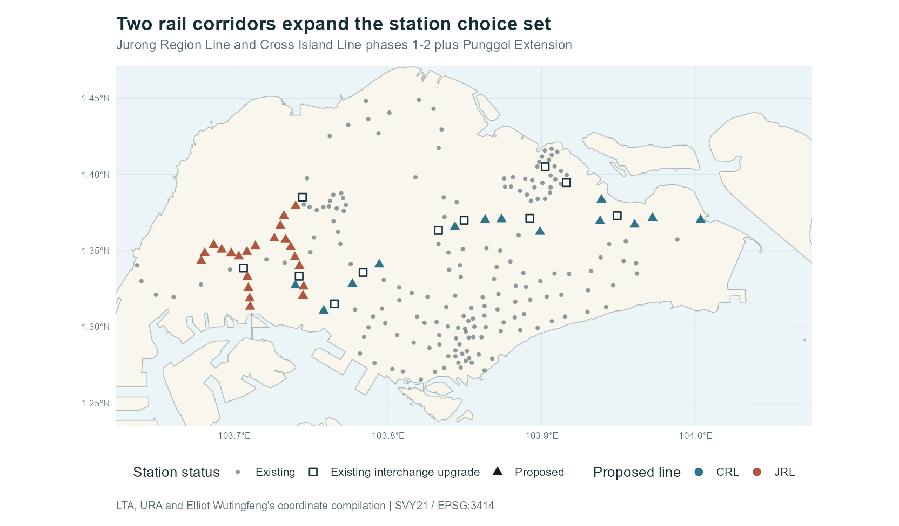
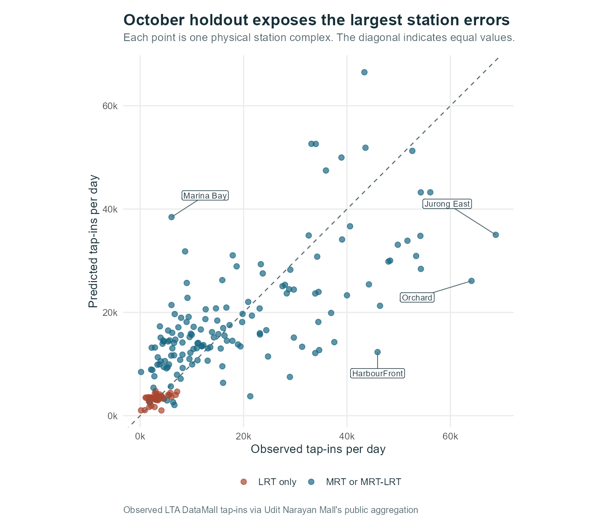
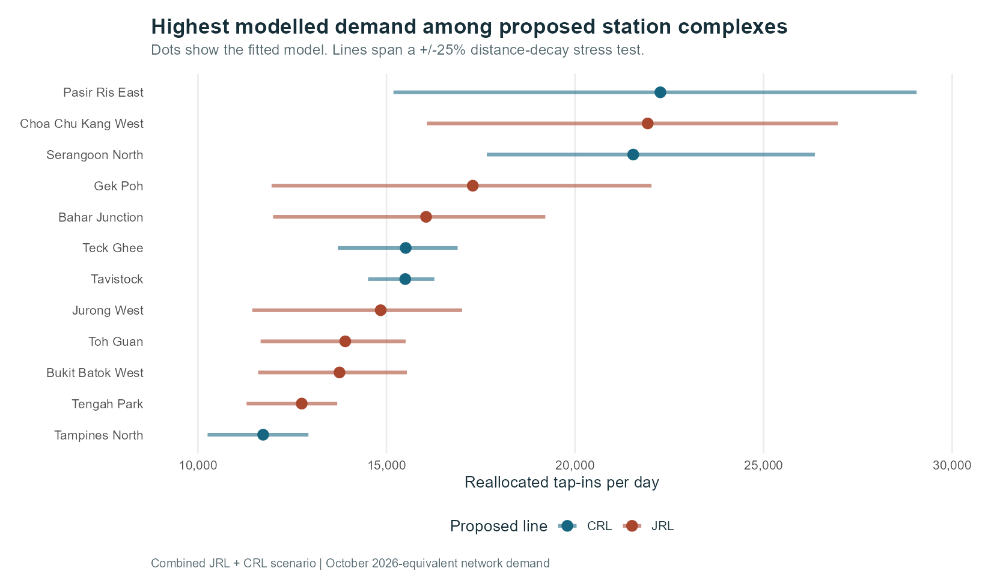
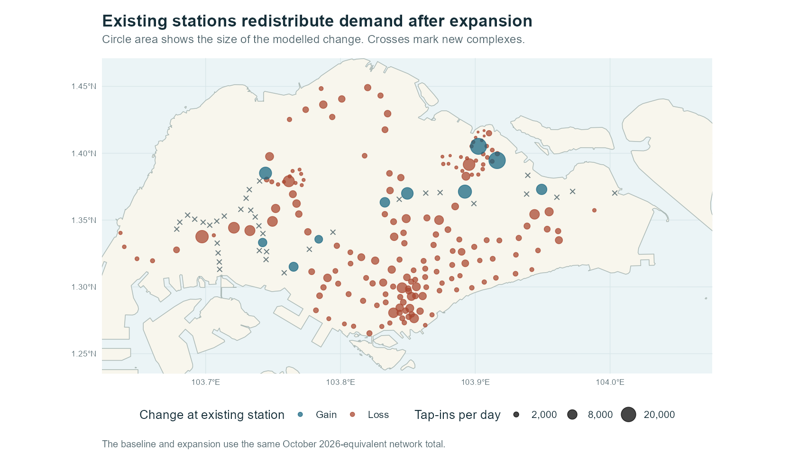
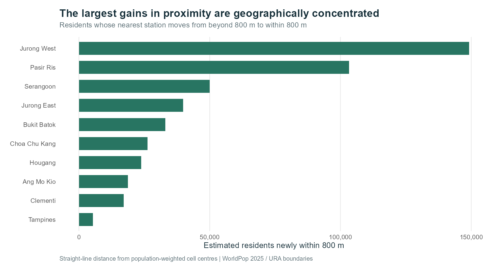

```{r}
#| include: false
out <- "take-home-exercise3/results"
data <- function(name) read.csv(file.path(out, paste0(name, ".csv")))
audit <- data("data_audit")
val <- data("model_validation")
scenarios <- data("scenario_totals")
stations <- data("destinations")
area <- data("access_by_planning_area")
blocks <- data("spatial_holdout")
best <- subset(val, period == "Holdout (Oct)" & model == "Attraction Huff")
near <- subset(val, period == "Holdout (Oct)" & model == "Nearest station")
distance_only <- subset(val, period == "Holdout (Oct)" & model == "Distance-only Huff")
both <- subset(scenarios, scenario == "Both")
new <- subset(stations, status == "Proposed")
new <- new[order(-new$expanded_taps), ]
existing <- subset(stations, status == "Existing")
loss <- existing[which.min(existing$delta_taps), ]
gain <- existing[which.max(existing$delta_taps), ]
a <- function(x) audit$value[match(x, audit$item)]
f <- function(x, d = 0) formatC(x, digits = d, format = "f", big.mark = ",")
```

## Contents

1. Study question and data
2. Station choice and validation
3. Expansion results and existing station impacts
4. Residential access and planning implications

## How might new rail change where people board?

::: {.columns}
::: {.column width="35%"}
- Baseline of **`r a("baseline_complexes")`** physical MRT/LRT complexes.
- JRL and CRL phases 1–2 plus the Punggol Extension add **`r both$new_complexes`** new complexes.
- **`r a("interchange_upgrades")`** existing interchanges gain a service.
:::
::: {.column width="65%"}
{fig-alt="Map of existing and planned rail stations in Singapore."}
:::
:::

## Data for station choice

::: {.columns}
::: {.column width="50%"}
### Where demand starts

**`r f(a("origin_cells"))` residential cells** at 500 m resolution, weighted by WorldPop 2025.

LTA and URA geometry locates station complexes and planning areas.
:::
::: {.column width="50%"}
### What makes a station attractive

Nearby bus stops and HDB buildings, number of services, MRT status and proximity to Raffles Place.

Average daily **tap-ins** from LTA DataMall’s public station aggregation.
:::
:::

August–September 2026 for calibration. October 2026 held out.

## How the model distributes boardings

Each residential cell splits its trips across all available stations.

- **Distance** reduces the chance of choosing a station. The fitted decay is `r f(data("coefficients")$coefficient[1], 2)`.
- **Attraction** accounts for differences such as more rail services and feeder stops.
- **Calibration** matches predicted station shares to observed shares.
- **Expansion** uses the same model and keeps October-equivalent system demand fixed.

## Validation finds both an improvement and large errors

::: {.columns}
::: {.column width="42%"}
### October WAPE

| Model | Error |
|:--|--:|
| Nearest station | `r f(near$wape_pct, 1)`% |
| Distance-only Huff | `r f(distance_only$wape_pct, 1)`% |
| **Attraction Huff** | **`r f(best$wape_pct, 1)`%** |

Mean absolute error is **`r f(best$mae)`** entries per station per day. Geographic transfer is weakest in the Central Region.
:::
::: {.column width="58%"}
{fig-alt="Observed versus predicted October boardings, with the largest errors labelled."}
:::
:::

## New stations attract about `r f(both$new_taps / both$network_taps * 100, 1)`% of modelled demand

::: {.columns}
::: {.column width="34%"}
About **`r f(both$new_taps)`** daily boardings move to new complexes.

The highest estimates are at **`r new$station[1]`**, **`r new$station[2]`** and **`r new$station[3]`**.

The ranges test sensitivity to how quickly demand falls with distance.
:::
::: {.column width="66%"}
{fig-alt="Ranked demand and distance-decay sensitivity for the top 12 proposed stations."}
:::
:::

## Demand shifts across existing station catchments

{fig-alt="Map showing where existing stations gain or lose modelled boardings." .wide-figure}

**`r loss$station`** has the largest modelled loss (`r f(abs(loss$delta_taps))` daily boardings). **`r gain$station`** has the largest gain (`r f(gain$delta_taps)`).

## Nearly `r f(a("newly_within_800m") / 1000)` thousand residents gain a station within 800 m

::: {.columns}
::: {.column width="36%"}
**`r tools::toTitleCase(tolower(area$planning_area[1]))`** and **`r tools::toTitleCase(tolower(area$planning_area[2]))`** account for `r f(sum(area$newly_within_800m[1:2]) / a("newly_within_800m") * 100, 1)`% of the gain.

The 800 m threshold measures straight-line proximity from populated cell centres. Pedestrian connections determine how much of this gain residents can use.
:::
::: {.column width="64%"}
{fig-alt="Top planning areas where residents gain an 800-metre station."}
:::
:::

## Use the results to prioritise field checks

- **New stations.** Check whether pedestrian crossings, entrances and feeder buses serve the places where proximity improves.
- **Upgraded interchanges.** Compare modelled entry gains with circulation and station access constraints.
- **Forecast limits.** Future housing, jobs, network walking routes, operating patterns and newly induced trips could change the results. The estimates describe one fixed-demand scenario.

[Technical report](technical-report.html) · [Exercise overview](index.html) · [GitHub](https://github.com/zhenhuaArhci/isss626-coursework/tree/main/take-home-exercise3)
