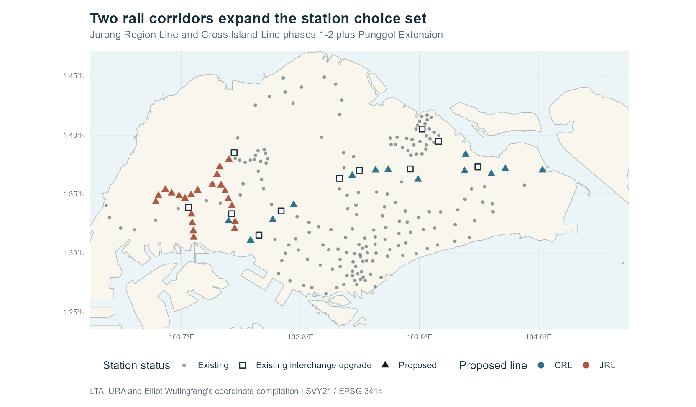

How could Singapore’s Jurong Region Line and Cross Island Line redistribute daily MRT/LRT boardings and change residential access to rail? This exercise calibrates a station-choice model on observed 2026 tap-ins and compares the existing network with an expansion scenario.

- [Technical report](technical-report.qmd) covers the data audit, R workflow, calibration, validation, maps and limitations.
- [Executive summary](executive-summary.qmd) presents the main results in a Quarto revealjs deck.
- [GitHub project](https://github.com/zhenhuaArhci/isss626-coursework/tree/main/take-home-exercise3) contains the source, scripts and station-level results.
- [RStudio reproduction instructions](README.md) list the commands to rebuild the analysis.

{fig-alt="Map of Singapore showing existing rail station complexes, upgraded interchanges, and proposed Jurong Region Line and Cross Island Line station locations."}

The expansion includes the Jurong Region Line and Cross Island Line phases 1–2 and the Punggol Extension. Future demand estimates redistribute a fixed October 2026-equivalent total.

[Course assignment brief](https://isss626-ay2026-27aug.netlify.app/take-home_ex03) · [Data and licensing notes](data/README.md)
