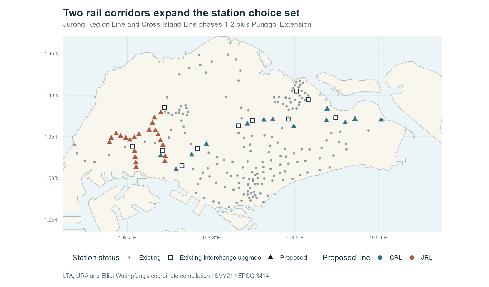
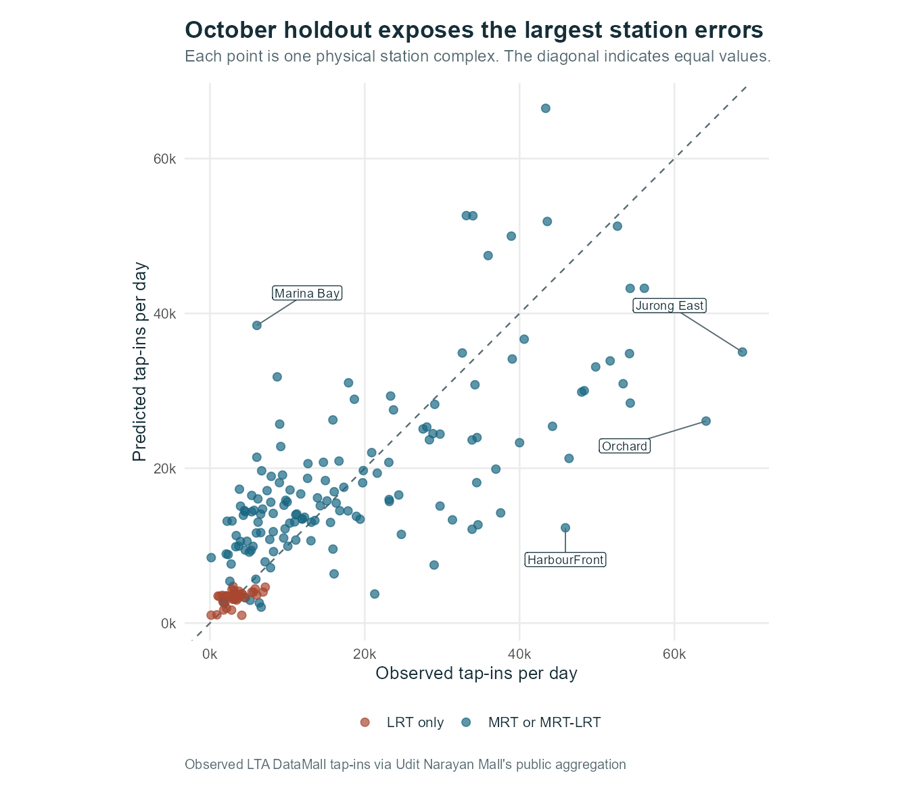
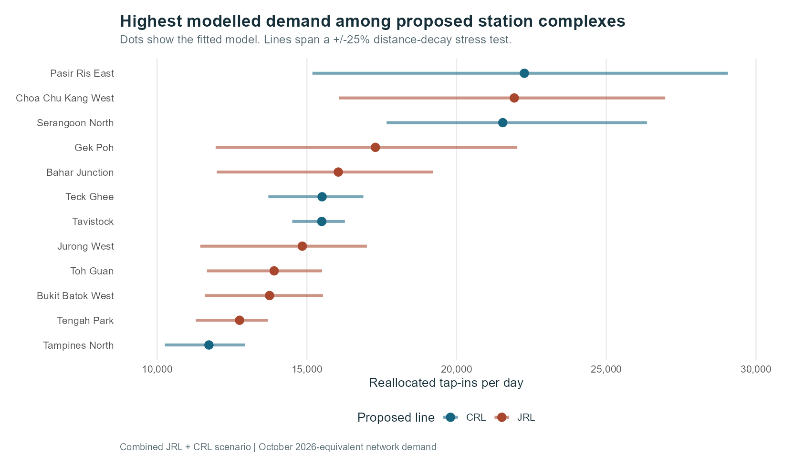
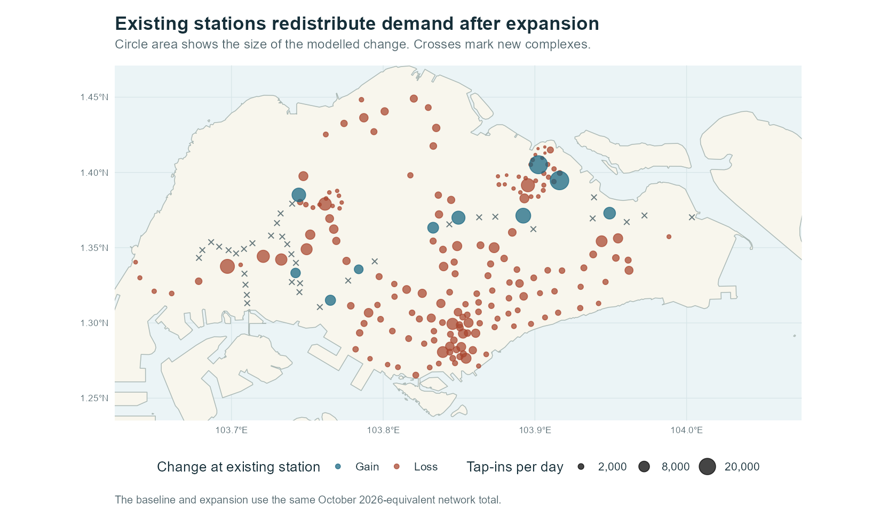
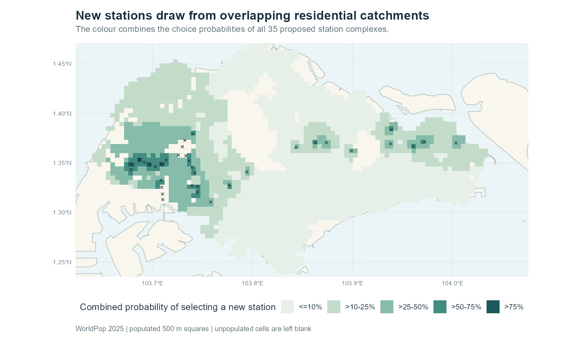
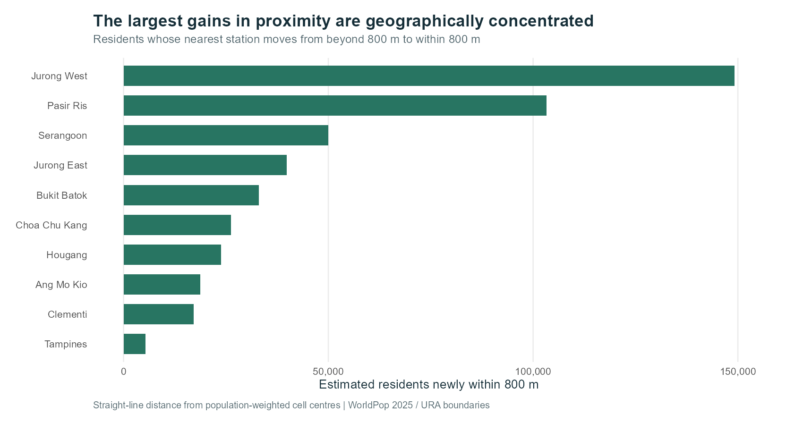

[Exercise overview](index.qmd) · [Executive summary](executive-summary.qmd) · [GitHub source](https://github.com/zhenhuaArhci/isss626-coursework/tree/main/take-home-exercise3)

```{r}
#| label: rebuild-analysis
#| output: false
source("take-home-exercise3/R/run.R", local = TRUE, encoding = "UTF-8")
fmt <- function(x, digits = 0) formatC(x, format = "f", digits = digits, big.mark = ",")
table <- function(data, ...) knitr::kable(as.data.frame(data), ...)
october <- validation[period == "Holdout (Oct)"]
best <- october[model == "Attraction Huff"]
combined <- scenario_totals[scenario == "Both"]
top_new <- destinations[status == "Proposed"][order(-expanded_taps)][1:5]
largest_loss <- destinations[status == "Existing"][order(delta_taps)][1:5]
largest_gain <- destinations[status == "Existing"][order(-delta_taps)][1:5]
new_access <- sum(origins$market_population[origins$newly_within_800m])
changed <- weighted.mean(origins$baseline_choice != origins$expanded_choice, origins$market_population)
central <- blocks[region == "CENTRAL REGION"]
```

## Research questions

1. How well can a probabilistic spatial interaction model explain daily boardings at existing MRT/LRT station complexes?
2. Which proposed complexes could attract the most boardings under today’s residential geography and observed network demand?
3. How might the new stations reshape existing station catchments, and which planning areas gain the most proximity to rail?

Singapore’s land-use and transport planning benefit from examining demand across the entire network. A station can draw users away from several established stations, and an existing interchange can attract more entries after adding a line. Both effects matter for planning station entrances, pedestrian access and feeder services.

{fig-alt="Existing MRT/LRT complexes, proposed JRL and CRL stations, and existing interchanges that gain a planned line."}

The baseline covers `r nrow(stations)` physical MRT/LRT complexes with positive observations in every study period. The expansion adds `r nrow(new_stations)` new complexes and adds services to `r nrow(existing_upgrades)` existing complexes. The Cross Island Line scenario covers phases 1–2 and the Punggol Extension. CRL phase 3, Changi Terminal 5, and openings on other lines fall outside this scenario.

## Data and quality checks

| Input | Vintage | Role |
|:--|:--|:--|
| LTA DataMall rail station footprints | September 2026 | Baseline facility locations |
| LTA DataMall Passenger Volume by Train Stations, public aggregation by Udit Narayan Mall | August–October 2026 | Hourly tap-in averages by station and day type |
| Future rail coordinates compiled by Elliot Wutingfeng | Pinned repository revision | Planned facility locations and codes |
| WorldPop Global2 R2025A v1 constrained estimate | 2025, about 100 m | Residential market potential |
| LTA bus stop locations | September 2026 | Feeder connectivity proxy |
| HDB Existing Building | Downloaded November 2026 | Nearby HDB building count |
| URA Master Plan 2019 planning areas, land only | 2019 planning geography | Spatial joins, mapping and geographic holdout |

Links, licensing, checksum provenance and pinned revisions are listed in the [data notes](data/README.md) and [input manifest](data/input-checksums.csv).

### Station and passenger records

The calibration target is **average daily tap-ins**, representing paid-area entries. The public aggregate preserves separate weekday and weekend/public-holiday averages for each hour. The R code sums the available hours and weights the two day types by their reported day counts. The input averages are rounded to whole taps per hour before aggregation. August and September are weighted by their number of days for fitting. October is held out for validation. The resulting October total covers the stations and hours in this input. Within-system transfers, alightings and inferred journeys by rail line are outside this measure.

The mirror lists two rows for Stevens (DT10 and TE11). The workflow sums their counts and treats them as one complex. It expands slash-delimited facility codes in the LTA footprint archive, unions distinct matching footprints, and uses their centroid as the station location. Proposed sites are matched to existing complexes by normalised names. The largest coordinate separation among name-matched interchanges is `r fmt(max(distance_check))` m. The workflow checks for unmerged proposed points very close to existing stations. The expansion adds a service to an existing interchange without creating a second boarding location. The Pasir Ris CRL mainline and branch codes count as one additional service.

```{r}
#| label: geometry-audit
table(audit[!item %in% c("training_daily_taps", "october_daily_taps",
                         "newly_within_800m", "distance_only_decay")],
      digits = 2, col.names = c("Audit item", "Value"))
```

### Residential market and attraction

All spatial operations use **SVY21 / Singapore TM (EPSG:3414)**. Each positive WorldPop raster cell is transformed by its centre and assigned to one 500 m square. Population is summed without resampling, and population-weighted centres represent origins. The population total is checked before and after aggregation. URA planning areas are attached by spatial intersection. Points outside the 2019 polygons retain an explicit label.

Each destination has operating bus stop counts within 500 m, HDB building counts within 800 m, its number of distinct MRT/LRT services, an MRT service indicator and distance to Raffles Place as a proxy for centrality. Buffers measure proximity in metres. Bus stop counts omit service frequency and building counts omit dwelling capacity. These variables represent distinct aspects of station attraction and access. Future stations use observed surrounding land use and bus locations, so large future developments may change their relative attractiveness.

### Two spatial interaction tables

The same `r fmt(nrow(origins))` residential origins are paired with every eligible destination. The baseline has `r fmt(interaction_counts[["existing"]])` pairs and the expansion has `r fmt(interaction_counts[["expanded"]])`. The pair key is `origin, destination`. Each row carries straight-line distance in metres, market population, the attraction covariates and fitted choice probability. The [origin table](results/origins.csv) and [destination table](results/destinations.csv) use the same keys. Full tables are generated into `data/derived/`; the report exposes [baseline](results/interactions-existing-sample.csv) and [expansion](results/interactions-expanded-sample.csv) samples.

```{r}
#| label: interaction-example
sample_file <- file.path(results, "interactions-expanded-sample.csv")
sample <- fread(sample_file)
table(sample[1:4, .(origin, destination, distance_m, probability, bus_500m, hdb_800m)],
      digits = 4)
```

## Probabilistic station choice

For residential cell $i$ and station complex $j$, the Huff probability is

$$
P_{ij} =
\frac{\exp(\mathbf{x}_j^\mathsf{T}\boldsymbol\gamma)\,\tilde d_{ij}^{-\beta}}
{\sum_{k\in S}\exp(\mathbf{x}_k^\mathsf{T}\boldsymbol\gamma)\,\tilde d_{ik}^{-\beta}},
\qquad
\tilde d_{ij}=\max(d_{ij},150\text{ m})/1000 .
$$

The 150 m floor prevents almost-coincident centres from dominating the distance term. Log-transformed bus, HDB and CBD variables and the two service measures are standardised on existing stations and use the same scaling in all scenarios. Attraction is learned from station marginals. There are no observed home-to-station assignments in the calibration data.

The predicted share of a station is the population-weighted average of its choice probabilities. Fitting minimises cross-entropy against the observed station share, with a ridge penalty of $0.001\lVert\gamma\rVert^2/2$ on attraction coefficients to limit the effect of collinear covariates. L-BFGS-B fits distance decay and the attraction coefficients jointly. A nearest-station assignment of the residential market and a fitted distance-only Huff model provide two reference models. All models allocate the same total for each comparison. The code checks row sums and system totals.

```{r}
#| label: estimated-coefficients
table(data.table(term = names(theta), estimate = unname(theta)), digits = 3)
```

The estimated distance decay is `r fmt(theta[1], 2)`. The fitted attraction is higher for better-connected stations, MRT service and more nearby bus stops, after adjustment for the other measured factors. The small negative HDB coefficient and the centrality coefficient may reflect differences between suburban residential areas and major employment destinations. They are associations in a model fit to aggregate boardings.

### Temporal and geographic validation

The October holdout keeps both fitted parameters and the system total from August–September fixed. WAPE divides total absolute error by observed total tap-ins. MAE and RMSE are in tap-ins per day, and Spearman measures rank agreement.

```{r}
#| label: validation-table
table(validation, digits = 2, col.names = c("Model", "Period", "MAE", "RMSE", "WAPE (%)", "Spearman"))
```

{fig-alt="Scatter plot of observed against predicted daily station tap-ins for October 2026, with a one-to-one reference line."}

Attraction Huff achieves **`r fmt(best$wape_pct, 1)`% WAPE**, a mean absolute error of **`r fmt(best$mae)` daily tap-ins** and a rank correlation of **`r fmt(best$spearman, 2)`**. The largest discrepancies show why the model is more suitable for comparing broad catchment patterns than setting station-level capacity.

A second check leaves out each URA region in turn, fits on the remaining station labels and evaluates the **within-region** distribution of October taps, conditional on that region’s observed total. All facilities remain available as alternatives. The check tests spatial transfer of shares, not whether the model predicts a region’s overall passenger volume.

```{r}
#| label: spatial-validation
table(blocks, digits = 1, col.names = c("Held-out region", "Stations", "Attraction WAPE (%)", "Distance WAPE (%)"))
```

Central Region transfer is particularly weak (`r fmt(central$attraction_wape_pct, 1)`% WAPE). Central employment, tourism and special destinations are represented only indirectly by a CBD-distance term. This spatial error limits confidence in future locations with atypical land use.

## Expansion and catchment effects

The scenario reuses the calibrated parameters and scales all four networks to the `r fmt(test_total)` daily boardings observed in the October input. The change is a reallocation of observed demand under a new station choice set. It assumes fixed residential population, fixed regional trip production and unchanged attraction at facilities except for new service counts or MRT service.

```{r}
#| label: scenario-table
shown <- scenario_totals[, .(scenario, complexes, new_complexes, new_taps, existing_taps, network_taps)]
table(shown, digits = 0, format.args = list(big.mark = ","),
      col.names = c("Network", "Complexes", "New complexes", "New taps/day", "Existing taps/day", "Network taps/day"))
```

In the joint scenario the new stations receive **`r fmt(combined$new_taps)` daily boardings** or **`r fmt(100 * combined$new_taps / combined$network_taps, 1)`%** of the modelled total. The separate-line allocations cannot be added directly because the same origin cells can choose from both corridors when both are available.

{fig-alt="Ranked new stations and scenario ranges from a 25 percent change in the distance decay coefficient."}

The highest modelled demand is at **`r top_new$station[1]`** (`r fmt(top_new$expanded_taps[1])` daily boardings), followed by `r top_new$station[2]` and `r top_new$station[3]`. The horizontal ranges vary the fitted distance-decay coefficient by ±25% while holding attraction terms fixed. They show sensitivity to access behaviour under this model. Sampling error, land-use changes and service-level changes are additional uncertainties.

{fig-alt="Map of daily boarding gains and losses at existing stations, with new stations marked as crosses."}

The largest modelled loss is at **`r largest_loss$station[1]`** (`r fmt(abs(largest_loss$delta_taps[1]))` daily boardings). **`r largest_gain$station[1]`** has the largest gain (`r fmt(largest_gain$delta_taps[1])`), reflecting the extra service and the local choice set. Both values compare the fitted expansion against the fitted baseline at the same network total. The [station results](results/destinations.csv) include the signed change and its percentage.

{fig-alt="Population-grid map of combined probability of boarding at any proposed station after expansion."}

The most likely station changes for cells representing **`r fmt(100 * changed, 1)`%** of the mapped population. The map sums all new-station choice probabilities within each populated square. It shows shared catchments even where a new station is a secondary choice, and the highest concentrations are local to the new corridors.

### Added analysis: who gets physically closer to rail?

The choice model can shift predicted boardings without bringing the nearest station closer. A separate access calculation compares nearest-station distance at each population-weighted cell centre before and after expansion. The threshold is **800 m straight-line**, a screening measure rather than an observed walking time. All origins are weighted by their WorldPop estimates.

{fig-alt="Bar chart of estimated residents gaining an 800-metre station in the leading planning areas."}

About **`r fmt(new_access)` residents** live in cells moving from farther than 800 m to within 800 m of rail. `r tools::toTitleCase(tolower(access$planning_area[1]))` and `r tools::toTitleCase(tolower(access$planning_area[2]))` account for **`r fmt(100 * sum(access$newly_within_800m[1:2]) / new_access, 1)`%** of this gain. This highlights pedestrian connections where new rail is likely to expand proximity as well as redistribute existing demand. A park, expressway or inaccessible crossing can make real walking distance longer. A separate network walk audit would be needed to evaluate these barriers.

## Planning interpretation and limitations

- **Station and street design.** Compare the higher-demand proposed sites with pedestrian routes, crossing capacity, step-free access and feeder coverage. Check the areas with increased attraction at upgraded interchanges for crowding and vertical circulation.
- **Feeder service design.** Stations with large modelled losses offer a starting point for testing alternative bus connections. Tap-ins here measure entries and give limited information about transfer or platform loads.
- **Limits of inference.** Residential population does not represent jobs, visitors, airports or institutional demand well. Straight-line distance ignores barriers and network connectivity. The model omits service frequency, fares, rail travel times and trips induced by expansion. It also assumes that station shares are reallocated proportionally through the Huff choice set. The temporal holdout is a nearby month, and the region holdout documents weaker spatial transfer.

## Reproduce in RStudio

Open [the project repository](https://github.com/zhenhuaArhci/isss626-coursework) as `ISSS626-GAA.Rproj`. The [setup guide](README.md) covers packages, execution and outputs. This HTML report reruns the workflow through its first R chunk. The same analysis can be started from the RStudio Console.

```r
source("take-home-exercise3/R/run.R")
```

- [Download and provenance script](R/download-data.R)
- [Spatial data preparation script](R/prepare-data.R)
- [Huff fitting, validation and scenario script](R/fit-model.R)
- [Maps and charts script](R/visualise.R)
- [Download the station and catchment results](results/destinations.csv) · [Grid-level results](results/catchment_grid.csv) · [Planning area access results](results/access_by_planning_area.csv)

## References

- [ISSS626 Take-home Exercise 3 brief](https://isss626-ay2026-27aug.netlify.app/take-home_ex03)
- [LTA DataMall dynamic data](https://datamall.lta.gov.sg/content/datamall/en/dynamic-data.html) and [static data](https://datamall.lta.gov.sg/content/datamall/en/static-data.html)
- [LTA Jurong Region Line](https://www.lta.gov.sg/content/ltagov/en/upcoming_projects/rail_expansion/jurong_region_line.html) and [LTA Cross Island Line](https://www.lta.gov.sg/content/ltagov/en/upcoming_projects/rail_expansion/cross_island_line.html)
- [WorldPop Global2 population counts](https://hub.worldpop.org/project/categories?id=3)
- [Zhu et al. (2021), Improved Huff Model for Estimating Urban Rail Transit Station Catchment Areas considering Station Choices](https://doi.org/10.1155/2021/6374724)
